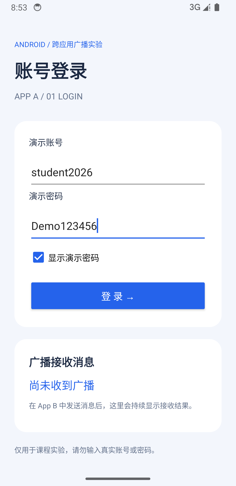
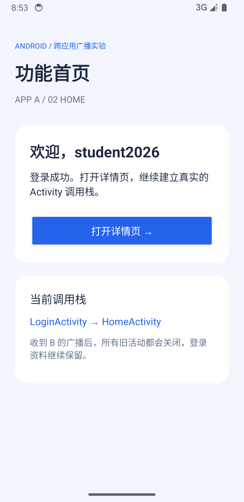
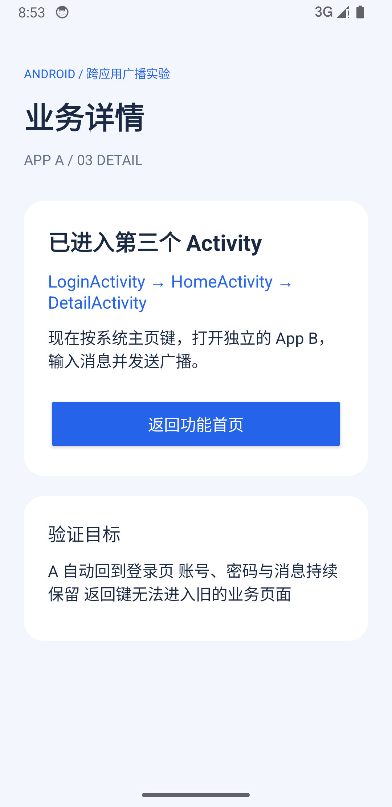
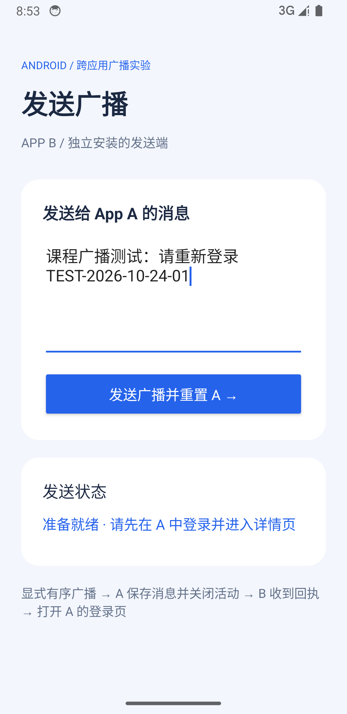
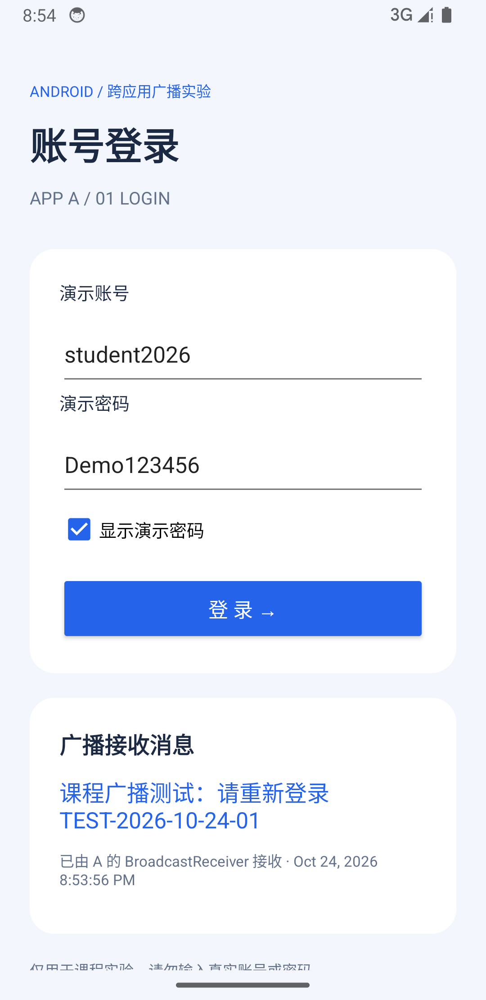

# Android 跨应用广播与 Activity 重置作业

两个真正独立安装的 Android App，使用 **Java + XML**，无第三方运行依赖。B 发送自定义广播，A 保存消息、关闭全部旧 Activity，回到保留演示账号和密码的登录页。

| App | 模块 / applicationId | 页面 |
| --- | --- | --- |
| A · 活动重置 | `app-a` / `com.example.broadcast.receiver` | LoginActivity → HomeActivity → DetailActivity |
| B · 广播发送 | `app-b` / `com.example.broadcast.sender` | SenderActivity：输入消息、发送、显示回执 |

## 运行

使用 Android Studio 打开本仓库根目录，等待 Gradle 同步。先运行 `app-a`，再运行 `app-b`，两个 App 安装在同一台设备上。Android 6.0（API 23）及以上可安装；本次实际验证环境为 Android 14 / API 34 ARM64 模拟器。

1. 打开 A，输入演示账号 `student2026`、演示密码 `Demo123456`。勾选“显示演示密码”可方便对照。
2. 点击登录进入首页，再点击“打开详情页”。登录页不会被提前 finish，形成真实的三层调用栈。
3. 按系统主页键，打开独立的 B，输入消息，点击“发送广播并重置 A”。
4. A 返回登录页，账号、密码及广播消息均保留。按系统返回键，不能回到原来的首页或详情页。

完整安装、截图、ADB 与发布步骤见 [RUN_AND_SCREENSHOT.md](RUN_AND_SCREENSHOT.md)。可直接安装 [App A APK](apks/app-a-debug.apk) 和 [App B APK](apks/app-b-debug.apk)，二者来自本次相同签名的构建。APK 校验值见 [SHA256SUMS](apks/SHA256SUMS)。

## 核心流程

```text
前台 B：显式有序广播（消息仅在广播中传递）
  → A 的 Manifest Receiver：校验 action、持久化消息 commit、finishAll
  → A 返回 RESULT_OK 与请求编号
  → B 的最终接收器：校验成功回执
  → 前台 B 显式启动 A 登录页，NEW_TASK | CLEAR_TASK
  → A 登录页从自身 SharedPreferences 读取资料和广播消息
```

A 的 Receiver 不从后台直接启动 Activity。B 等待有序广播处理结束后才打开 A，避免 Android 10 起的后台启动限制及数据读取竞态。启动登录页的 Intent **没有消息 Extras**，不会把普通 Activity 跳转伪装成广播。B 若暂时不在前台，会延后到恢复前台再打开 A。

接收器在 Manifest 中声明 `exported="true"`，使用显式 ComponentName 定位；另加 `signature` 级权限，只允许与 A 同签名的 B 触发。请使用同一次工程构建的两个 APK；两模块默认 debug 签名相同。Home、Detail 不导出。只保存演示资料，勿输入真实凭据。

## 真实运行截图

以下 PNG 均为本次 Android 14 模拟器经 `adb exec-out screencap -p` 直接截取的完整屏幕，无绘制或拼接。

| 01 · A 输入登录信息 | 02 · A 功能首页 |
| --- | --- |
|  |  |

| 03 · A 业务详情 | 04 · 独立 App B 发送端 |
| --- | --- |
|  |  |

### 05 · 收到广播后重新打开的 A 登录页



## 验证记录

- `:app-a:assembleDebug :app-b:assembleDebug :app-a:lintDebug :app-b:lintDebug` 已通过，两个模块 Lint 均无错误。
- 真实设备自动化脚本验证三层调用栈、Receiver 清理数量和三个旧 Activity 的 `onDestroy` 日志。
- 验证重置后 A 任务仅有 LoginActivity，返回键无法回到旧 Home/Detail。
- 验证账号、明文演示密码和消息完全匹配，重新打开 A 仍显示消息。
- 验证 A 后台进程被 `am kill` 回收后，静态接收器仍接收广播；第二条消息替换第一条。
- Android 版本升级提示属于 Lint 警告；工程使用本机已有 API 34 SDK。未声称对其他系统版本做过实机测试。

实际结果见 [设备验证记录](evidence/device-verification.txt)、[生命周期日志](evidence/lifecycle.log)、[广播前任务栈](evidence/before-reset-task.txt)、[重置后任务栈](evidence/reset-task.txt)、[返回后任务栈](evidence/after-back-task.txt)。

## 关键代码

- [ActivityCollector.java](app-a/src/main/java/com/example/broadcast/receiver/ActivityCollector.java)：集中管理并关闭 Activity。
- [BasicActivity.java](app-a/src/main/java/com/example/broadcast/receiver/BasicActivity.java)：统一注册、移除及生命周期日志。
- [ResetReceiver.java](app-a/src/main/java/com/example/broadcast/receiver/ResetReceiver.java)：真实接收广播、同步保存消息、清理活动、返回回执。
- [LoginActivity.java](app-a/src/main/java/com/example/broadcast/receiver/LoginActivity.java)：保存输入、恢复资料、持续展示最新消息。
- [SenderActivity.java](app-b/src/main/java/com/example/broadcast/sender/SenderActivity.java)：显式有序广播与成功后打开 A。
- [A Manifest](app-a/src/main/AndroidManifest.xml)、[B Manifest](app-b/src/main/AndroidManifest.xml)：独立应用及组件权限。
- [设备自动验证脚本](tools/verify_device.py)：只使用 Python 标准库与 ADB；会清空本项目 A、B 的演示数据并重新截图。

技术依据：[Android 官方广播文档](https://developer.android.com/develop/background-work/background-tasks/broadcasts)、[后台 Activity 启动限制](https://developer.android.com/guide/components/activities/background-starts)、[任务与返回栈](https://developer.android.com/guide/components/activities/tasks-and-back-stack)。
